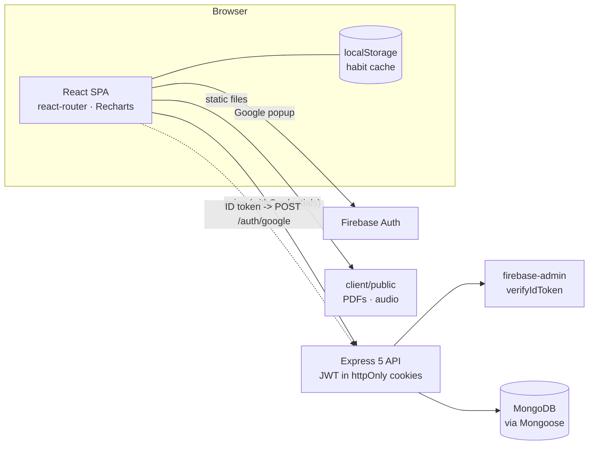
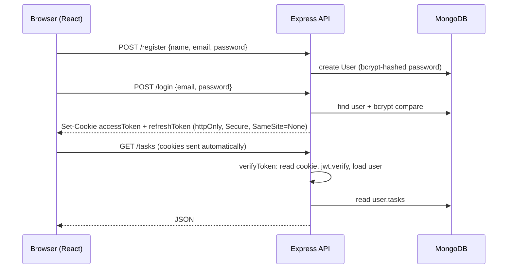
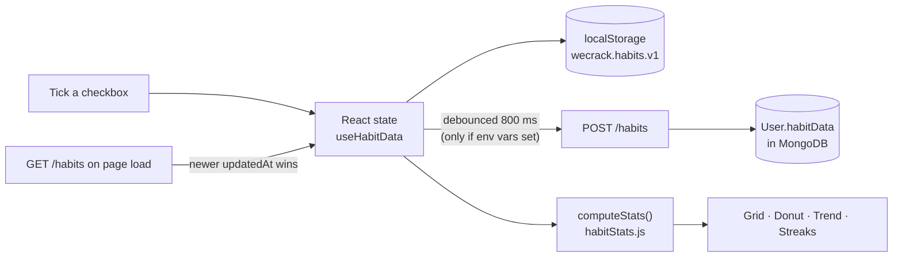
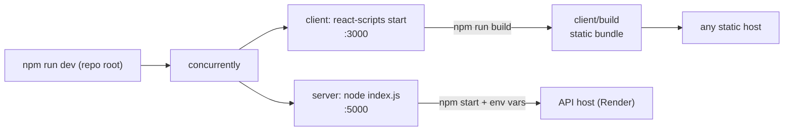

# WeCrack

A full-stack **GATE preparation tracker**. Plan your study tasks, keep your syllabus, previous-year papers and mock tests in one place, log notes and scores, and — new — track your **daily habits** with a monthly grid, completion donut, trend chart and streaks.

> **Stack:** React 19 · React Router 7 · Recharts · Firebase Auth · Express 5 · MongoDB (Mongoose) · JWT cookies

---

## Table of contents

1. [Features](#features)
2. [Architecture](#architecture)
3. [Pipelines](#pipelines)
   - [Authentication pipeline](#1-authentication-pipeline)
   - [Dashboard data pipeline](#2-dashboard-data-pipeline)
   - [Habit tracker pipeline](#3-habit-tracker-pipeline)
   - [Development, build and deploy pipeline](#4-development-build-and-deploy-pipeline)
4. [Project structure](#project-structure)
5. [Getting started](#getting-started)
6. [Environment variables](#environment-variables)
7. [API reference](#api-reference)
8. [Data model](#data-model)
9. [Habit tracker in detail](#habit-tracker-in-detail)
10. [Security notes](#security-notes)
11. [Known issues and roadmap](#known-issues-and-roadmap)
12. [License](#license)

---

## Features

**Account**
- Register / log in with email and password (passwords hashed with bcrypt).
- "Sign in with Google" through Firebase Authentication, verified on the server with `firebase-admin`.
- Session kept in `httpOnly` cookies (access token + refresh token).

**Dashboard** (`/dashboard`)
- **Smart Planner** – per-subject study tasks (DSA, OS, CN, DBMS, COA, Math) that you can add, tick off and delete.
- **Syllabus** – official GATE 2025 syllabus PDFs, selectable by branch, opened in a viewer.
- **Previous papers** – GATE PYQs (2019 CSE, 2020 CSE, 2021 Set 1 & 2, 2022, 2023) with view / download.
- **Mock tests** – five bundled mock-test PDFs, plus score entry; the last scores, highest score, average and total tests are shown in **Your Stats**.
- **Pinned notes** – title + content notes saved to your account.
- **Completed topics** – a running list of topics you have finished.
- **Timer & stopwatch** and a small **music player**.
- **Daily motivation** quotes.
- **Daily Habits card** – today's checklist, month %, and current streak, linking to the full tracker.

**Habit tracker** (`/habits`)
- Month grid of habits × days with one-click checkboxes (any past day or today; future days are locked).
- Month **donut** (Done / Not done / Upcoming) with the completion percentage in the centre.
- **Daily completion** trend chart with a chart/table toggle.
- **Stats**: perfect days, current streak, best streak, check-ins, and a per-habit breakdown with progress bars, streaks, and "Strongest / Needs attention" tags.
- Month navigation, add / rename / delete habits.
- Saved in the browser instantly; optionally synced to your account (see [pipeline 3](#3-habit-tracker-pipeline)).

**Landing page** (`/`) – a marketing page describing the product vision (AI study buddy, streak challenges, focus mode, quiz battles, …). The functionality that is implemented today is what the dashboard and API above provide.

---

## Architecture



- **Client** (`client/`) is a Create React App single-page application. Styling is inline-style based with a shared beige / black palette.
- **Server** (`server/`) is a stateless Express API. All user data (tasks, notes, scores, syllabus, topics, habits) lives in one `User` document in MongoDB.
- **Static study material** (syllabus, PYQs, mock tests, audio) is served straight from `client/public`.

---

## Pipelines

### 1. Authentication pipeline

Email + password:



Google sign-in:

1. The browser opens the Firebase Google popup (`client/src/Screens/FireBase.js`).
2. Firebase returns an **ID token**; the client sends it to `POST /auth/google`.
3. The server verifies it with `firebase-admin`, finds the user by e-mail (or creates one with `isGoogleUser: true`), and sets the same two cookies as a normal login.
4. Every protected route goes through the `verifyToken` middleware (`server/middleware/auth.js`), which reads the `accessToken` cookie, verifies the JWT and attaches the user to `req.user`.

### 2. Dashboard data pipeline

On load, `dashboard.jsx` fires these requests in parallel and stores the results in React state:

| Request | Fills |
| --- | --- |
| `GET /userdetails` | welcome header |
| `GET /tasks` | Smart Planner |
| `GET /getmarks` | Performance Analytics, Your Stats |
| `GET /get-notes` | Pinned Notes |
| `GET /get-analytics` | analytics state (fetched; not shown in the UI yet) |
| `GET /get-syllabus-progress` | Completed Topics |

Writes (`POST /add-task`, `/update-tasks`, `/delete-task`, `/mockscore`, `/save-notes`, `/update-syllabus-progress`) update the `User` document and the UI. Ticking a task is **optimistic**: the UI flips immediately and the change is posted in the background.

The dashboard also calls `GET /ping` every 10 minutes so the free-tier API host does not go to sleep.

### 3. Habit tracker pipeline



- Works **offline / without a backend**: every change is written to `localStorage` immediately.
- If both `REACT_APP_GET_HABITS` and `REACT_APP_SAVE_HABITS` are set, the page also **pulls once on load** (the copy with the newer `updatedAt` wins) and **pushes edits** (debounced) to `/habits`, so your data follows your account across devices. The header shows the status: *Saved on this device · Syncing… · Synced to your account · Offline*.
- The server validates and sanitises the payload (max 50 habits, name ≤ 40 chars, `YYYY-MM-DD` keys only, unknown habit ids dropped, future timestamps clamped).
- All statistics are **computed in the browser** from the raw ticks by pure functions in `habitStats.js`.

### 4. Development, build and deploy pipeline



| Stage | Command | Notes |
| --- | --- | --- |
| Install | `npm install` in root, `client/`, `server/` | root holds `concurrently`, `recharts`, `chart.js` |
| Develop | `npm run dev` (root) | runs API and client together |
| Build client | `cd client && npm run build` | outputs `client/build` |
| Run API | `cd server && npm start` | needs the server env vars below |

There is no CI workflow in the repository yet (see [roadmap](#known-issues-and-roadmap)).

---

## Project structure

```text
wecrack/
├── package.json                 # root scripts: dev / client / server
├── client/                      # React app (Create React App)
│   ├── public/
│   │   ├── Gate_Syallbus/       # GATE 2025 syllabus PDFs per branch
│   │   ├── Gate_PYQs/           # previous-year papers
│   │   ├── Gate_Mock/           # mock-test PDFs
│   │   └── Music/               # background music (Git LFS)
│   └── src/
│       ├── App.js               # routes: / /login /register /dashboard /habits
│       └── Screens/
│           ├── HomeScreen/      # landing page
│           ├── LoginScreen/     # email + Google sign-in
│           ├── RegisterScreen/
│           ├── Dashboard/       # main study dashboard
│           ├── HabitTracker/
│           │   ├── HabitTracker.jsx      # full page: grid, donut, trend, stats
│           │   ├── HabitSummaryCard.jsx  # compact card used on the dashboard
│           │   ├── useHabitData.js       # state + localStorage + optional sync
│           │   └── habitStats.js         # pure date / streak / statistics maths
│           └── FireBase.js      # Firebase web SDK + Google login helper
└── server/                      # Express API
    ├── index.js                 # app setup, CORS, cookies, DB connection
    ├── config/db.js             # Mongoose connection
    ├── routes/Routes.js         # all routes
    ├── controllers/user.controller.js
    ├── middleware/auth.js       # verifyToken (JWT from cookie)
    └── models/user.Model.js     # User schema
```

---

## Getting started

**Prerequisites:** Node.js 18+, npm, a MongoDB database (local or hosted), and a Firebase project (for Google sign-in).

```bash
git clone https://github.com/yashasvi0904/wecrack.git
cd wecrack

# install dependencies (three package.json files)
npm install
(cd client && npm install)
(cd server && npm install)

# create the env files described below
#   server/.env
#   client/.env

# run API (port 5000) and client (port 3000) together
npm run dev
```

Open <http://localhost:3000>. Register an account, log in, and you land on `/dashboard`; the habit tracker is at `/habits`.

> The background music file is tracked with **Git LFS** (see `.gitattributes`). Install [git-lfs](https://git-lfs.com) before cloning if you want the real audio file.

---

## Environment variables

Never commit `.env` files — both `client/.gitignore` and `server/.gitignore` already exclude them.

### `server/.env`

| Variable | Required | Description |
| --- | --- | --- |
| `MONGO_URL` | yes | MongoDB connection string |
| `ACCESS_TOKEN_SECRET` | yes | secret used to sign access tokens |
| `ACCESS_TOKEN_SECRET_EXPIRE` | yes | access-token lifetime, e.g. `15m` |
| `REFRESH_TOKEN_SECRET` | yes | secret used to sign refresh tokens |
| `REFRESH_TOKEN_SECRET_EXPIRE` | yes | refresh-token lifetime, e.g. `7d` |
| `FIREBASE_ADMIN_CREDENTIALS` | yes | Firebase service-account JSON, as a **single-line JSON string** |
| `PORT` | no | defaults to `5000` |
| `CORS_ORIGINS` | no | comma-separated origins (currently read but not enforced; CORS reflects the request origin) |

### `client/.env`

Firebase web config (from the Firebase console → Project settings):

```env
REACT_APP_FIREBASE_API_KEY=
REACT_APP_FIREBASE_AUTH_DOMAIN=
REACT_APP_FIREBASE_PROJECT_ID=
REACT_APP_FIREBASE_STORAGE_BUCKET=
REACT_APP_FIREBASE_MESSAGING_SENDER_ID=
REACT_APP_FIREBASE_APP_ID=
REACT_APP_FIREBASE_MEASUREMENT_ID=
```

API endpoints. Each screen reads its own full URL; for a local server on port 5000 the values are:

```env
REACT_APP_REGISTER_USER=http://localhost:5000/register
REACT_APP_REGISTER_URI=http://localhost:5000/register
REACT_APP_LOGIN_URI=http://localhost:5000/login
REACT_APP_GOOGLE_AUTH_URI=http://localhost:5000/auth/google
REACT_APP_USER_DETAILS=http://localhost:5000/userdetails
REACT_APP_GET_TASK=http://localhost:5000/tasks
REACT_APP_ADD_TASK=http://localhost:5000/add-task
REACT_APP_TOGGLE_TASK=http://localhost:5000/update-tasks
REACT_APP_DELETE_TASK=http://localhost:5000/delete-task
REACT_APP_GET_NOTES=http://localhost:5000/get-notes
REACT_APP_ADD_NOTES=http://localhost:5000/save-notes
REACT_APP_SEND_SCORE=http://localhost:5000/mockscore
REACT_APP_HANDLE_MARKS=http://localhost:5000/getmarks
REACT_APP_GET_ANALYTICS=http://localhost:5000/get-analytics
REACT_APP_SYLLABUS=http://localhost:5000/get-syllabus-progress
REACT_APP_ADD_TOPICS=http://localhost:5000/update-syllabus-progress
REACT_APP_DELETE_TOPICS=http://localhost:5000/update-syllabus-progress
```

Habit tracker sync (optional — without these the tracker still works and saves in the browser):

```env
REACT_APP_GET_HABITS=http://localhost:5000/habits
REACT_APP_SAVE_HABITS=http://localhost:5000/habits
```

Restart the dev server after editing `.env`; Create React App reads it at start-up.

---

## API reference

All routes except the first four need the `accessToken` and `refreshToken` cookies (`withCredentials: true`).

| Method | Path | Auth | Purpose |
| --- | --- | :---: | --- |
| POST | `/register` | – | create an account |
| POST | `/login` | – | log in, set cookies |
| POST | `/auth/google` | – | log in with a Firebase ID token |
| GET | `/ping` | – | health check / keep-alive |
| GET | `/logout` | ✔ | invalidate the refresh token |
| GET | `/userdetails` | ✔ | current user |
| GET | `/tasks` | ✔ | list tasks |
| POST | `/add-task` | ✔ | add a task `{subject, title}` |
| POST | `/update-tasks` | ✔ | update a task `{_id, completed, subject, title}` |
| POST | `/delete-task` | ✔ | delete a task `{taskId}` |
| GET | `/get-notes` | ✔ | list notes |
| POST | `/add-note` | ✔ | add one note `{title, content}` |
| POST | `/save-notes` | ✔ | replace all notes `{notes: []}` |
| POST | `/delete-note` | ✔ | delete one note `{noteId}` |
| POST | `/mockscore` | ✔ | save a mock-test score `{marks}` |
| GET | `/getmarks` | ✔ | list saved scores |
| GET | `/get-analytics` | ✔ | syllabus %, accuracy, best streak, 30-day consistency |
| POST | `/update-topic` | ✔ | set one syllabus topic status |
| POST | `/update-syllabus-progress` | ✔ | replace the completed-topics list `{completedTopics}` |
| GET | `/get-syllabus-progress` | ✔ | completed-topics list |
| GET | `/habits` | ✔ | habit data `{habits, log, updatedAt}` |
| POST | `/habits` | ✔ | save habit data (validated and sanitised) |

---

## Data model

One `User` document per account (`server/models/user.Model.js`):

| Field | Type | Notes |
| --- | --- | --- |
| `name`, `email`, `password` | string | `password` is bcrypt-hashed; optional for Google users |
| `isGoogleUser` | boolean | |
| `refreshToken` | string | current refresh token |
| `tasks` | `[{subject, title, completed}]` | Smart Planner |
| `mockscore` | `[number]` | mock-test scores |
| `notes` | `[{title, content}]` | pinned notes |
| `syllabus` | `[{subject, topic, status}]` | `Not Started` / `In Progress` / `Completed` |
| `topics` | `[string]` | completed-topics list |
| `activityLog` | `[string]` | `YYYY-MM-DD` dates used by `/get-analytics` |
| `habitData` | `{habits, log, updatedAt}` | habit tracker, see below |

`habitData` shape:

```json
{
  "habits": [{ "id": "h1abc", "name": "Gym", "icon": "🏋️", "createdAt": "2026-10-01" }],
  "log":    { "2026-10-18": ["h1abc"], "2026-10-19": ["h1abc", "h2def"] },
  "updatedAt": 1792400000000
}
```

`log` maps a calendar day (local time, `YYYY-MM-DD`) to the ids of the habits completed that day.

---

## Habit tracker in detail

How the numbers on `/habits` are calculated (`client/src/Screens/HabitTracker/habitStats.js`):

| Number | Definition |
| --- | --- |
| **Tracked days of a habit** | from its creation date (or the earliest day you back-filled) up to today — days before a habit existed are never counted as missed |
| **Done** | ticked cells in the month, up to and including today |
| **Not done** | tracked cells up to today that are not ticked |
| **Upcoming** | cells for the remaining days of the month |
| **Completion %** (donut centre) | Done ÷ (Done + Not done) |
| **Daily %** (trend chart) | habits ticked that day ÷ habits tracked that day; future days have no point |
| **Perfect day** | every tracked habit ticked |
| **Current streak** | consecutive days ending today with at least one habit done; an empty *today* does not break the streak until the day is over |
| **Best streak** | longest such run, across all months |
| **Per-habit streak** | same rules, for a single habit |

Dates are plain local-calendar strings, so time zones never move a tick to a different day, and the grid rolls over at midnight without a reload.

---

## Security notes

- Passwords are hashed with bcrypt; tokens are signed JWTs delivered in `httpOnly`, `Secure`, `SameSite=None` cookies, so JavaScript cannot read them. Because the cookies are `Secure`, use HTTPS in production (browsers accept them on `localhost` for development).
- Secrets live only in `.env` files / host environment variables; none are in the source. If a secret was ever committed in another repository, rotate it.
- The habit endpoint validates input shape and size before writing to the database.

---

## Known issues and roadmap

Things noticed while documenting the project, in rough priority order:

- [ ] `server/middleware/auth.js` requires `../models/user.model` while the file is `user.Model.js` — fine on Windows/macOS, but breaks on case-sensitive Linux hosts. Rename one to match the other.
- [ ] The notes **Delete** button posts an empty list to `/save-notes`, which clears *all* notes; use `POST /delete-note` with the note id instead.
- [ ] `/admin-dashboard` is navigated to for `role === "admin"` but no such route exists in `App.js`, and the `User` schema has no `role` field.
- [ ] The music player lists `Song2.mp3`, which is not in `client/public/Music/`.
- [ ] The Architecture (AR) syllabus PDF sits at the repository root instead of `client/public/Gate_Syallbus/`.
- [ ] `recharts` and `chart.js` are declared in the **root** `package.json`; move the ones the client uses into `client/package.json`.
- [ ] `CORS_ORIGINS` is parsed but the server currently allows any origin (`origin: true`); restrict it for production.
- [ ] `/get-analytics` expects score objects (`{correct, total}`) while `/mockscore` stores plain numbers, so *accuracy* is not meaningful yet.
- [ ] Add automated tests and a CI workflow (build the client, lint, run tests on every push).
- [ ] The landing-page features (AI study buddy, quiz battles, …) are not implemented yet.

---

## License

ISC (as declared in `package.json`).
